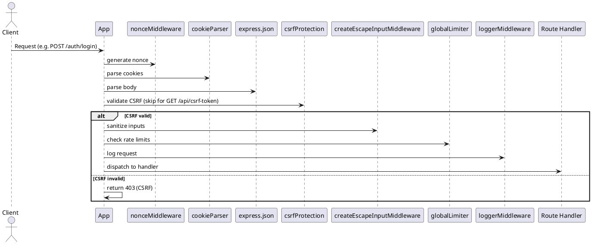

# Security Middleware Overview

This document describes how the security-related middleware in the ExpressBlog application work together to provide CSRF protection, input sanitization, CSP nonces, rate limiting, and auth enforcement.

## Goals
- Prevent CSRF attacks while allowing clients to fetch a CSRF token.
- Apply content security policy with per-request nonces.
- Sanitize incoming input to reduce XSS/injection risk.
- Reject requests with invalid content types for JSON endpoints.
- Apply global and strict rate limits.

## Middleware Order (high-level)
1. `helmet` (CSP, HSTS, etc.)
2. `nonceMiddleware` (generates per-request CSP nonce)
3. `compression`
4. `cookieParser`
5. `express.json` / `express.urlencoded`
6. `csrfProtection` (except `GET /api/csrf-token`)
7. CSRF error handler (early error handling)
8. `createEscapeInputMiddleware` (input sanitization)
9. Rate limiting (`globalLimiter`)
10. `loggerMiddleware`
11. Routes
12. Celebrate validation errors handler
13. 404 handler
14. Global error handler (`errorHandlerMiddleware`)

## Sequence Diagram (ASCII)

Client -> App: GET /api/csrf-token
App -> nonceMiddleware: generate nonce
App -> cookieParser: parse cookies
App -> express.json: parse body
App -> csrfMiddleware: SKIP for /api/csrf-token
App -> route handler: utilityRoutes -> return token
App -> Client: 200 { csrfToken }

Client -> App: POST /auth/login (with csrf header)
App -> nonceMiddleware: generate nonce
App -> cookieParser: parse cookies
App -> express.json: parse body
App -> csrfMiddleware: validate header vs cookie
alt CSRF valid
  App -> createEscapeInputMiddleware: sanitize inputs
  App -> globalLimiter: check rate limits
  App -> loggerMiddleware: log request
  App -> authController: process login
else CSRF invalid
  App -> CSRF error handler: return 403
end

## Components Detail

### CSRF Protection
- Implemented via `@dr.pogodin/csurf` in `utils/csrf.js`.
- Uses cookie-based tokens (`_csrf`) with `httpOnly`, `sameSite: 'lax'`, and `secure` in production.
- Accepts tokens from headers `x-csrf-token`, `x-xsrf-token`, `csrf-token` or request body `_csrf`.
- `app.js` mounts `csrfProtection` globally but explicitly skips it for `GET /api/csrf-token` to avoid the token-fetch chicken-and-egg problem.
- If CSRF validation fails, an early error handler logs minimal diagnostics and returns `403`.

### CSP Nonce
- `nonceMiddleware` generates a secure random base64 nonce and adds it to `res.locals.nonce` for templates.
- It augments the existing `Content-Security-Policy` header to include `'nonce-{value}'` in `script-src` and `style-src`.

### Input Sanitization
- `createEscapeInputMiddleware` recursively escapes strings in `req.body`, `req.query`, `req.params`, and selected `req.cookies` fields.
- Whitelisted fields (e.g. `content`, `description`) are sanitized with DOMPurify via `utils.sanitizeHtml` rather than escaped.
- File upload filenames are sanitized using `utils.sanitizeFilename`.

### Rate Limiting
- Implemented with `express-rate-limit` and configured in `utils/limiters.js`.
- `globalLimiter` applied to dynamic routes; static assets are skipped.
- `strictLimiter` used for admin/API endpoints.
- `loginLimiter` protects the login endpoint.

### Auth Middleware
- `authenticateToken` extracts token from `Authorization` header or auth cookie and verifies with `authService.verifyToken`.
- Injects `req.user` on success.
- `requireAdmin` ensures `req.user.role === 'admin'`.

## PlantUML Diagram

Below is a PlantUML diagram you can paste into an editor supporting PlantUML to visualize the flow.

## Operational Notes
- Ensure `cookieParser` and body parsers run before CSRF middleware — otherwise `@dr.pogodin/csurf` cannot read the cookie or the body and will fail.
- Keep the token endpoint at `GET /api/csrf-token` and ensure `app.js` continues to skip CSRF for this path.
- Use `sameSite: 'lax'` for the CSRF cookie to allow same-site navigation while still mitigating cross-site POSTs.
- Avoid adding route-level CSRF on the token endpoint to prevent accidental protection.

---

If you want I can:
- produce a PNG/SVG of the PlantUML diagram and add it to `docs/` (requires PlantUML or `plantuml` CLI locally), or
- expand the documentation with sequence diagrams for other flows (login, create-post, upload), or
- add a short `SECURITY.md` file summarizing these guidelines for deploys.
